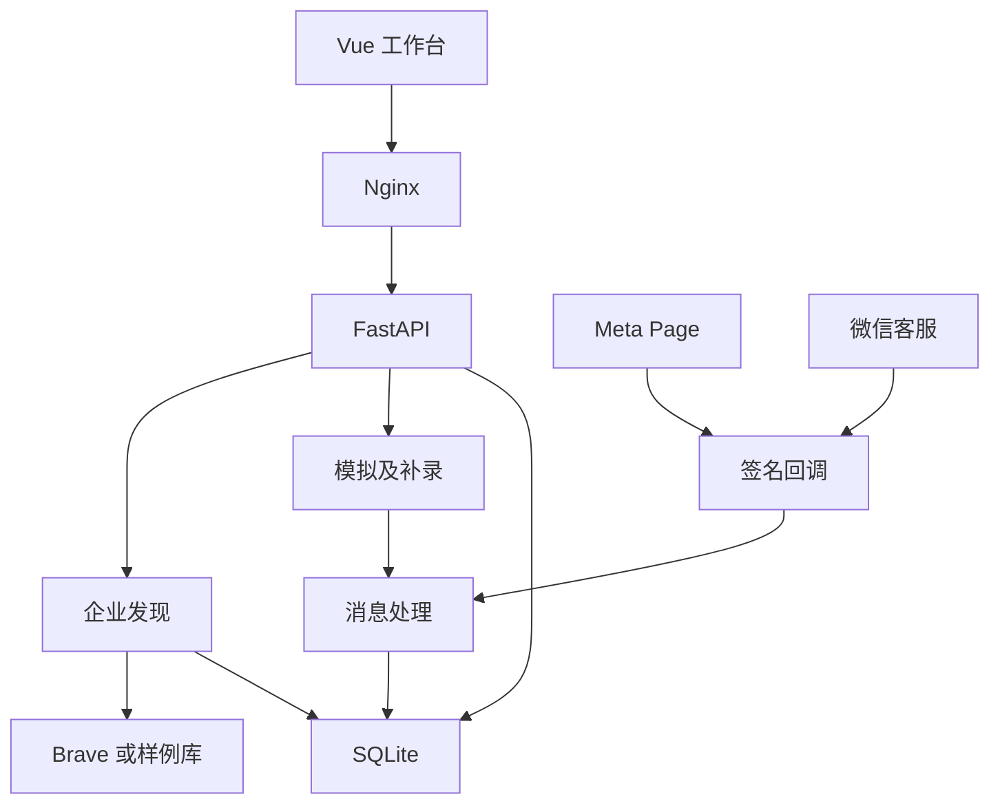

# 海外销售工作台设计

## 范围与使用者

拓客销售核实目标企业，值班销售接住夜间来信，区域销售接手后补资料、登记回复并进入后续报价。每天约十条询价的规模适合单个 FastAPI 服务和 SQLite 命名卷。工作台把来源证据、客户原话、可操作的下一步放在同一个视图。市场名、语言、公司自述只作为判断线索。

## 系统关系

浏览器采用同源请求。Compose 用 Nginx 提供 Vue 文件并转发 API 及回调。本地开发可直接用 FastAPI 提供同一套静态文件。每个新请求使用独立 SQLite 连接，开启外键、等待锁及 WAL；多个写入通过短事务串行。部署目标为单实例单 worker，数据卷使用本地文件系统。扩展多副本时需引入共享数据库及微信游标锁。

## 主动发现与证据

1. 将输入市场、客户类型和可选关键词转换成面向买家的检索词。车队对应自营维修场景，维修厂对应商用车维修场景。保存实际使用的检索式供核查。
2. 样例模式只从带核查日期和来源的名单筛选。实时模式经服务端搜索，按结果域名抑制重复，展示来源摘要与链接。这一版以搜索摘要为证据线索，由销售打开原页复核，目录站域名不会自动登记为买家官网。
3. 明确记录“待核实／可直接采购／委托采购／仅转售”。同一家企业可以从事维修及配件业务。网站、企业社交主页和公开业务联系方式与客户消息分别保存。
4. 请求加入档案时，用已确认的官网域名或同名同市场匹配。重复添加不会覆盖销售修改。域名存在集团共用的情形，门店可记录在备注中；需要分立的业务实体可单独建立具有可区分名称的档案。

## 询盘模型与状态

| 实体 | 主键或关联 | 业务含义 |
|---|---|---|
| companies | 企业 ID、非空官网域名唯一 | 销售维护的潜客和来源证据 |
| inquiries | 询盘 ID、可空企业 ID | 独立的采购事项、负责人、意图、下一步、人工回复时间 |
| threads | 渠道＋账号＋会话键 | 后续消息的路由，不按相似昵称自动合并 |
| messages | 渠道＋账号＋事件 ID 唯一 | 不可改写的原来信、附件描述、原始接收时间及提取字段 |
| history | 询盘 ID | 交接、备注、回复登记、会话归并及责任变化 |
| cursors / channel_sync | 任务名 / 平台 | 渠道游标、样例初始化标记、最近回调处理情况 |

入站事件先检查唯一键，完成文本提取后进入写事务，写入前再次检查。相同事件重试只返回已存在的询盘号。模拟、补录与平台账号隔离；合并后同步移动会话、消息和历史，旧事件重放仍指向目标询盘。两个不同企业的单据需要先核实才能合并。

原文、模型翻译、正则识别的数量和代码、客户角色自述分别保存。没有模型授权时使用本地规则，信息不足显示待判断；模型与规则的判断都可由销售纠正。文本和附件都不会触发自动外发。附件只保留说明或类型，原文件仍从原渠道访问。

处理状态为待处理、跟进中、等客户补充、已结束。每条消息单独记录是否已回复。登记回复时核对页面所见最新消息 ID，出现新来信时提醒销售重新阅读；跨渠道归并保留每条消息的已回复标记。延迟传入的历史消息进入时间线，较老消息不会覆盖最新意图。客户再次来信可重新打开已结束或等待中的工单。夜间队列依据最近夜班窗口内的未回复消息判断，因此早晨客户再补一条消息也不会掩盖夜间来信。

## 销售交互

- 桌面使用队列和详情双栏，手机先看紧凑队列，再看选中询盘。任一询盘均可查来源、编号、收件时间、消息数和负责人。
- 色彩区分状态，文字标签同步显示含义。原文、业务判断和人工记录分开。后台每 30 秒刷新队列，错误保留在页面上。
- 模拟器保留会话与事件编号，方便演示重试、时差和后续消息。真实回调状态独立于模拟器，缺权限或未收到回调会如实显示。
- 选择当前销售用于演示交接，不具备身份校验含义。生产运行应通过企业网关保护所有销售与管理接口。只有受签名保护的回调路径需要允许平台访问。

## 运行边界与后续衔接

来源限制和联调方式见 [渠道手册](docs/接口与渠道联调.md)。本迭代的客户档案和询盘号可作为未来孚盟 CRM 同步的外部键。正式 CRM 回写、主机厂 OE 映射、自动对外发信及报价放行均需要企业另行提供字段与授权。关键结果可按前 20 个候选的销售认可数、真实直接采购比例、未回复有效询盘数和跨班首响耗时评估；模拟数据不参与企业试点统计。
