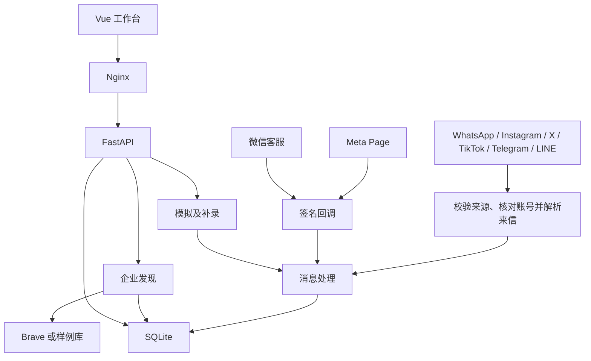

# 海外销售工作台设计

## 范围与使用者

拓客销售核实目标企业，值班销售接住夜间来信，区域销售接手后补资料、登记回复并进入后续报价。每天约十条询价的规模适合单个 FastAPI 服务和 SQLite 命名卷。工作台把来源证据、客户原话、可操作的下一步放在同一个视图。市场名、语言、公司自述只作为判断线索。

## 系统关系

国内搜索使用独立的 `domestic_signals` 索引。来源可为独立 MediaCrawler WebUI 的只读数据接口或用户选择的本地导出。平台、作品或评论类型、外部 ID、样例标记组成唯一键。评论可按作品 ID 补充产品上下文。第三方求购可在销售核实企业后关联档案，自有作品评论经确认后复用现有来信去重和分派逻辑。数据库初始化时会为已有部署创建该表。[国内渠道测试手册](docs/MediaCrawler国内渠道联调.md)

浏览器采用同源请求。Compose 用 Nginx 提供 Vue 文件并转发 API 及回调。本地开发可直接用 FastAPI 提供同一套静态文件。每个新请求使用独立 SQLite 连接，开启外键、等待锁及 WAL；多个写入通过短事务串行。部署目标为单实例单 worker，数据卷使用本地文件系统。扩展多副本时需引入共享数据库及微信游标锁。

## 主动发现与证据

1. 将输入市场、客户类型和可选关键词转换成面向买家的检索词。车队对应自营维修场景，维修厂对应商用车维修场景。保存实际使用的检索式供核查。
2. 样例模式只从带核查日期和来源的名单筛选。实时模式经服务端搜索，按结果域名抑制重复，展示来源摘要与链接。这一版以搜索摘要为证据线索，由销售打开原页复核，目录站域名不会自动登记为买家官网。
3. 明确记录“待核实／可直接采购／委托采购／仅转售”。同一家企业可以从事维修及配件业务。网站、企业社交主页和公开业务联系方式与客户消息分别保存。
4. 请求加入档案时，用已确认的官网域名或同名同市场匹配。重复添加不会覆盖销售修改。域名存在集团共用的情形，门店可记录在备注中；需要分立的业务实体可单独建立具有可区分名称的档案。

## 替代买家与竞争证据

- 销售手动从已关联企业的询盘发起查找。按市场、业务类别和商用车相关的公开证据筛选，排除原企业和重复企业，每次最多三家。排序优先考虑已有直接竞争依据、尚待处理的新潜客、已确认的采购能力和相同业务类型。采购能力单独沿用档案核实结论。
- 普通实时检索只使用市场和预设的买家类型词。未映射的市场采用通用行业查询，再用来源文本筛选地域。负责人主动点选「查找公开竞争线索」时，单独查询两家企业的名称与竞争关键词。网页摘要仅作线索，负责人可确认或撤回公开竞争依据。
- 推荐批次归询盘，采纳、排除与人工确认归原企业和候选企业这对记录。Copilot 按当前负责人查询待处理项，复用工作台的 30 秒刷新，同一对企业只提示一次。重新关联企业会清空原批次；合并询盘保留符合当前企业的最近批次。原处理记录和企业对的反馈继续保留。
- 外部搜索在数据库写事务外完成。提交批次前复核企业、负责人和上一批次。入档、反馈和跟进历史在同一事务提交，重复采纳复用已有档案及负责人。实时查询失败时保留前一次结果。

## 询盘模型与状态

| 实体 | 主键或关联 | 业务含义 |
|---|---|---|
| companies | 企业 ID、非空官网域名唯一 | 销售维护的潜客和来源证据 |
| inquiries | 询盘 ID、可空企业 ID | 独立的采购事项、负责人、意图、下一步、人工回复时间 |
| threads | 渠道＋账号＋会话键 | 后续消息的路由，不按相似昵称自动合并 |
| messages | 渠道＋账号＋事件 ID 唯一 | 不可改写的原来信、附件描述、原始接收时间及提取字段 |
| history | 询盘 ID | 交接、备注、回复登记、会话归并及责任变化 |
| cursors / channel_sync | 任务名 / 平台 | 渠道游标、样例初始化标记、最近回调处理情况 |

入站事件先检查唯一键，完成文本提取后进入写事务，写入前再次检查。相同事件重试只返回已存在的询盘号。模拟、补录与平台账号隔离；合并后同步移动会话、消息和历史，旧事件重放仍指向目标询盘。两个不同企业的单据需要先核实才能合并。

原文、模型翻译、正则识别的数量和代码、客户角色自述分别保存。没有模型授权时使用本地规则，信息不足显示待判断；模型与规则的判断都可由销售纠正。文本和附件都不会触发自动外发。附件只保留说明或类型，原文件仍从原渠道访问。

处理状态为待处理、跟进中、等客户补充、已结束。每条消息单独记录是否已回复。登记回复时核对页面所见最新消息 ID，出现新来信时提醒销售重新阅读；跨渠道归并保留每条消息的已回复标记。延迟传入的历史消息进入时间线，较老消息不会覆盖最新意图。客户再次来信可重新打开已结束或等待中的工单。夜间队列依据最近夜班窗口内的未回复消息判断，因此早晨客户再补一条消息也不会掩盖夜间来信。

## 销售交互

- 桌面使用队列和详情双栏，手机先看紧凑队列，再看选中询盘。任一询盘均可查来源、编号、收件时间、消息数和负责人。
- 色彩区分状态，文字标签同步显示含义。原文、业务判断和人工记录分开。后台每 30 秒刷新队列，错误保留在页面上。
- 模拟器保留会话与事件编号，方便演示重试、时差和后续消息。真实回调状态独立于模拟器，缺权限或未收到回调会如实显示。
- 「我的交接」、备注和回复登记均使用当前登录成员的唯一姓名。升级前的负责人继续显示，管理员可为同名销售开通账号以接续原工单。

## 身份、会话与成员

工作台面向同一销售团队。销售和管理员共享业务队列。管理员另有成员创建、密码重置和账号启停权限。登录名和显示名各自唯一，保持既有按姓名归属的工单与经办记录稳定。首位管理员通过部署端命令创建。登录页和个人账号面板沿用相同的 Noto 排版、Lucide 图标和动效 Token。

密码使用独立随机盐和 600,000 次 PBKDF2-HMAC-SHA256，数据库记录算法、迭代次数、盐和摘要。浏览器接收 HttpOnly、SameSite=Strict 的随机会话 Cookie，SQLite 仅保存令牌摘要、账号和绝对过期时间。登录、改密会轮换令牌，重置密码与停用账号会撤销所有会话。临时密码会话仅用于查看当前身份、改密或退出。业务经办人始终取自服务端会话。[密码存储参考](https://cheatsheetseries.owasp.org/cheatsheets/Password_Storage_Cheat_Sheet.html)

浏览器写请求携带自定义请求头，服务拒绝跨站浏览器写入。登录尝试按账号和连接来源限频。会话与业务响应使用 no-store。登录过期、退出或跨标签切换账号时，前端卸载之前的业务组件；再次登录可返回当前页面。

## 界面设计规范

工作台采用 Material Design 3 的排版角色与动效刻度，保留冠英的黑、橙、蓝品牌色。全局 Token 维护在 [tokens.css](src/web/tokens.css)，组件通过语义角色取值。新增页面优先复用现有角色，调整全局密度或字号时从 Token 入口修改。[Material 3 排版](https://m3.material.io/styles/typography/type-scale-tokens) · [Material 3 动效](https://m3.material.io/styles/motion/easing-and-duration/tokens-specs)

### 排版与图标

中文、拉丁文字和指标数字共用本地提供的 Noto Sans SC 可变字体。字体按 Unicode 范围加载，指标数字使用等宽数字特性。下表列出浏览器默认字号下的像素值，实现中用 rem 响应用户字号设置。中文标题与品牌数字使用半粗或粗体。[Noto Sans SC](https://fonts.google.com/noto/specimen/Noto+Sans+SC)

| 使用场景 | 字号 / 行高 | Token |
|---|---|---|
| 首页主标题 | 桌面 36 / 44，手机 28 / 36 | `--type-display`、`--type-headline-medium` |
| 页面标题、关键指标 | 32 / 40，手机指标 28 / 36 | `--type-headline-large`、`--type-headline-medium` |
| 详情与抽屉标题、卡片标题 | 22 / 28、16 / 24 | `--type-title-large`、`--type-title` |
| 客户原话、手机表单输入 | 16 / 24 | `--type-body-large` |
| 正文、导航与常规操作 | 14 / 20 | `--type-body`、`--type-label` |
| 时间、来源、字段标签 | 12 / 16 | `--type-caption`、`--type-label-medium` |
| 英文栏目眉题 | 11 / 16 | `--type-label-small` |

图标统一使用 Lucide Vue 组件，业务语义与图标的映射集中在 [icons.ts](src/web/icons.ts)。行内图标 16、导航与常规操作 20、强调图标 24，统一描边 1.75。图标跟随文字颜色。纯图标按钮提供可访问名称，带文字的图标对屏幕阅读器隐藏。[Lucide Vue](https://lucide.dev/guide/vue/getting-started)

### 色彩、间距与层级

- 炭黑承担主要正文，蓝色承担数据与助手，橙色突出主要动作。选中、待回和异常状态同时使用可读文字。渠道图表与图例共用同一组渠道色 Token。
- 布局使用 4px 网格。紧凑标签允许 2px 微间距，常用控件与卡片按 8、12、16、20、24、32、40px 取值。控件、卡片与大面板分别采用 8、12、16px 圆角，紧凑标签可用 4px。
- 普通卡片、悬浮卡片、主视觉、模态层使用各自的阴影 Token。环境渐变与 Copilot 渐变集中定义，表单和正文使用浅色实底。

### 快速切换与组件动效

| 交互 | 时长 | 表现 |
|---|---|---|
| 按钮、筛选与选中态 | 100ms | 即时更新业务状态，背景、边框和文字颜色短过渡 |
| 导航切页、切换询盘、消息标签与简报主题 | 150ms | 新内容淡入并上移 4px，导航栏和工具栏保持稳定 |
| 简报抽屉、移动导航、客户编辑框 | 进入 200ms，退出 150ms | 抽屉沿开启方向移动，编辑框轻微上移，遮罩同步淡入淡出 |
| 操作结果提示 | 150ms | 短距离浮现与淡出 |

进入使用减速曲线，退出使用加速曲线，状态反馈使用标准曲线。内容移动使用 transform 与 opacity。快速连续切换直接响应最后一次选择，定时刷新保持当前组件与输入焦点。弹窗沿用原生 dialog 的焦点与 Escape 行为。系统开启“减少动态效果”时，页面、模态层和提示直接切换到目标状态，颜色、文字与焦点仍提供反馈。

### 数据加载反馈

首次读取时保留页面标题、导航与布局，用骨架占住数据区域。总览预留指标、优先跟进列表和环形图，收件箱预留队列与详情。切换询盘只替换详情，发起新搜索只替换候选结果。已有数据的定时或手动刷新保留原内容和未保存的跟进记录。

请求成功后立即显示内容，成功返回空数组才显示空状态。失败时显示错误与重试入口。骨架通过文字状态向屏幕阅读器说明进度，形状本身不接受输入；系统启用减少动态效果时使用静态占位。

## 运行边界与后续衔接

来源限制和联调方式见 [渠道手册](docs/接口与渠道联调.md)。本迭代的客户档案和询盘号可作为未来孚盟 CRM 同步的外部键。正式 CRM 回写、主机厂 OE 映射、自动对外发信及报价放行均需要企业另行提供字段与授权。关键结果可按前 20 个候选的销售认可数、真实直接采购比例、未回复有效询盘数和跨班首响耗时评估；模拟数据不参与企业试点统计。
